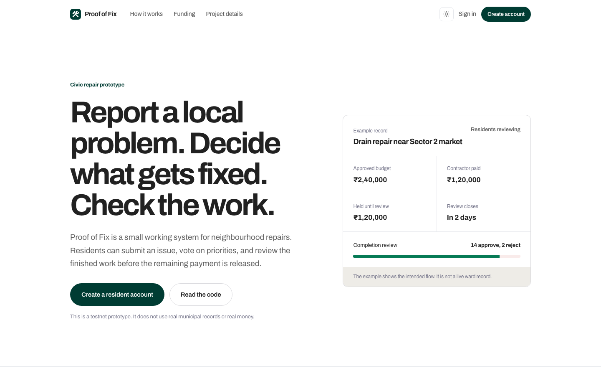
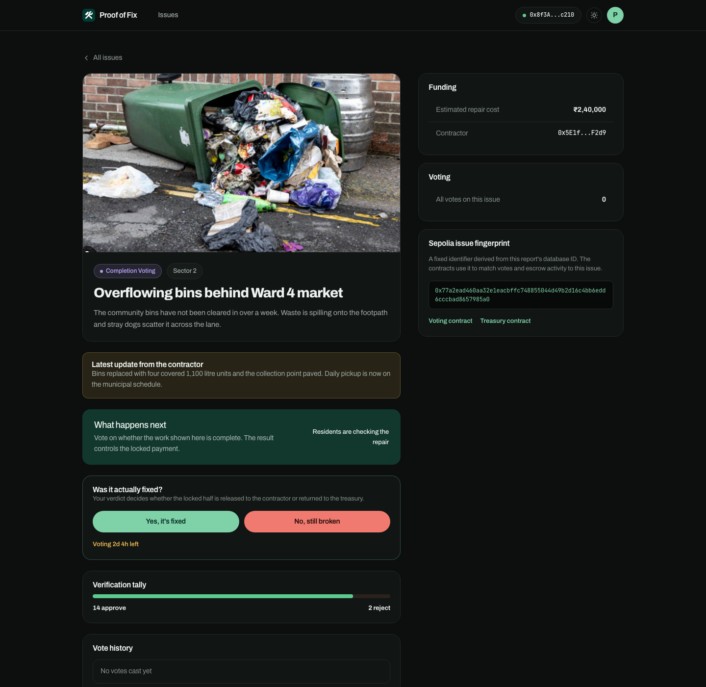
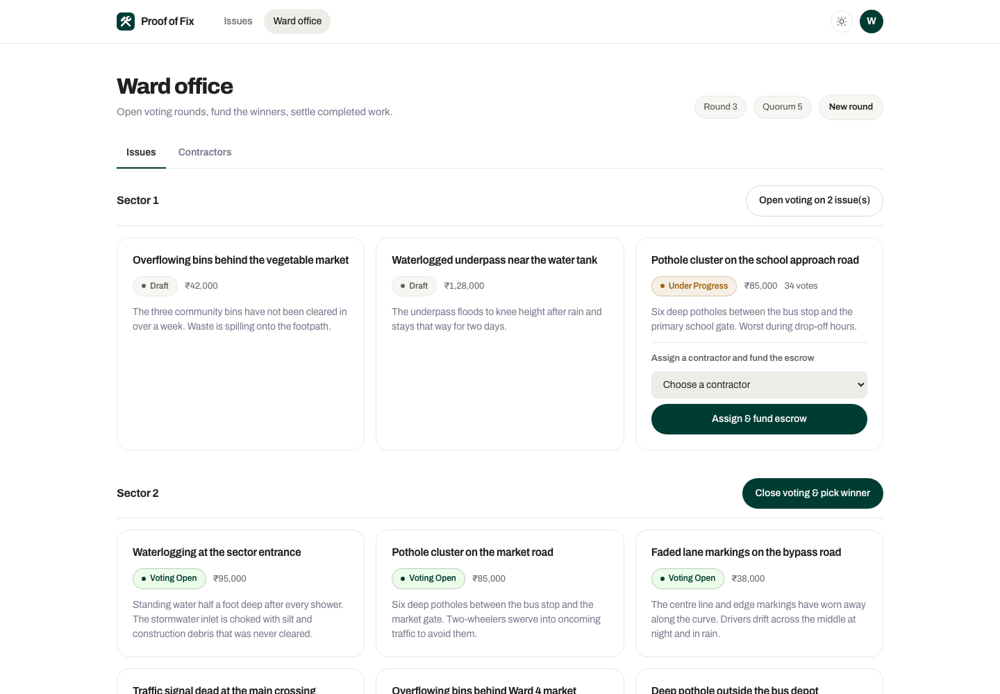
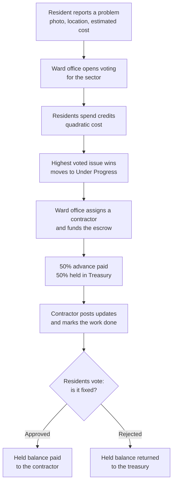
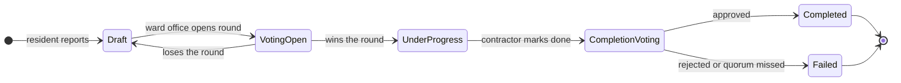
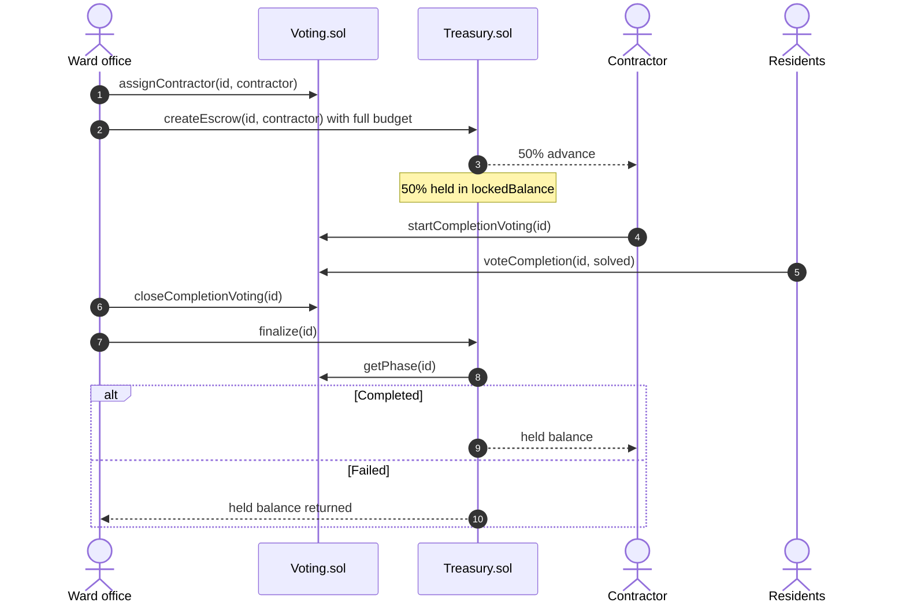
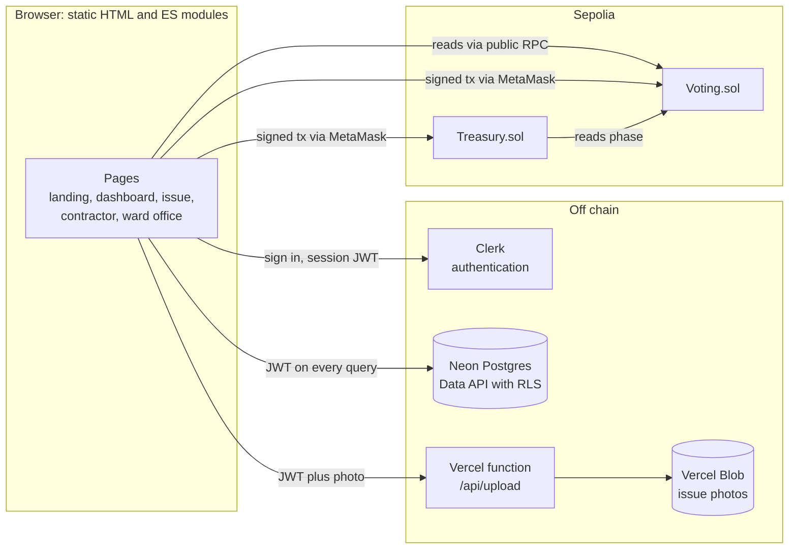
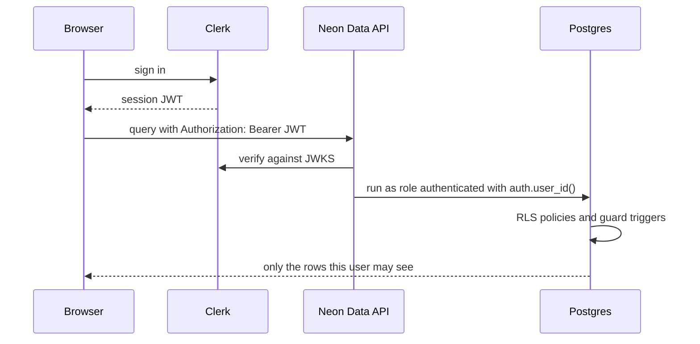

<p align="center">
  
</p>

<h1 align="center">Proof of Fix</h1>

<p align="center">
  Civic repair that residents prioritise, fund through escrow, and verify before the final payment.
</p>

<p align="center">
  ·
  <a href="#getting-started">Getting started</a>
  ·
  <a href="#architecture">Architecture</a>
  ·
  <a href="#smart-contracts">Contracts</a>
</p>

<p align="center">
  
  
  
  
  
</p>



## Overview

Public works spending is hard to audit from the outside. Residents rarely know which problems were prioritised, who was paid, or whether the work was actually completed.

Proof of Fix records the three decisions that matter on a public chain and keeps everything else in a conventional database:

| Decision | Where it lives | Mechanism |
| --- | --- | --- |
| Which problem gets funded | `Voting.sol` | Quadratic vote with 100 credits per resident per round |
| When money moves | `Treasury.sol` | Escrow: 50% advance, 50% held until verification |
| Whether the job was finished | `Voting.sol` | Resident completion vote with quorum and a 3 day window |

Descriptions, photos and profiles stay in Neon Postgres, protected by row level security. Storing them on chain would be expensive and would add nothing to accountability.

> This is a working testnet prototype. It uses Sepolia ETH and demo records, not real municipal data or money.

## Screenshots

<table>
  <tr>
    <td width="50%"></td>
    <td width="50%"></td>
  </tr>
  <tr>
    <td align="center"><sub><b>Resident dashboard.</b> Live vote totals and your own votes on every open issue.</sub></td>
    <td align="center"><sub><b>Priority vote.</b> Your votes, remaining credits and the cost of the next vote beside the action.</sub></td>
  </tr>
  <tr>
    <td width="50%"></td>
    <td width="50%"></td>
  </tr>
  <tr>
    <td align="center"><sub><b>Completion vote (dark mode).</b> Residents decide whether the held half is released.</sub></td>
    <td align="center"><sub><b>Ward office.</b> Open rounds, pick winners, assign a contractor and fund the escrow.</sub></td>
  </tr>
</table>

## How it works



### Issue lifecycle

Draft lives only in the database. Every later stage is mirrored by a phase in `Voting.sol`, so the chain is the source of truth for anything involving votes or money.



### Quadratic voting

Every resident receives 100 credits per round. Votes on a single issue cost the square of the running total, so each additional vote costs more than the last.

| Votes on one issue | Total credits spent | Cost of the next vote |
| ---: | ---: | ---: |
| 1 | 1 | 3 |
| 2 | 4 | 5 |
| 3 | 9 | 7 |
| 5 | 25 | 11 |
| 10 | 100 | n/a |

A resident can spread votes across several issues or concentrate them on one, but not both. Credits refill only when the ward office starts a new round, so spending them is a real decision.

### Escrow settlement



`finalize` runs once per issue and refuses to run while the completion vote is still open. There is no early release path, including for the ward office.

## Roles

| Role | How the account is created | What it can do |
| --- | --- | --- |
| Resident | Self sign up with a sector | Report issues, vote on priorities, verify completed work |
| Contractor | Resident account promoted by the ward office | Post work updates on assigned jobs, open the completion vote |
| Ward office | Promoted with `npm run make-admin` | Open and close rounds, assign contractors, fund and settle escrows |

Admin rights are never granted through the interface. The admin wallet funds escrows and settles payments, so it cannot be self service.

## Architecture



There is no application server. The browser talks to Neon's Data API directly, and authorisation is enforced inside Postgres:



### Data model

| Table | Contents |
| --- | --- |
| `profiles` | Name, sector, linked wallet (unique), `is_contractor`, `is_admin` |
| `problems` | Title, description, photo URL, cost, status, contractor wallet, escrow and settlement tx hashes |

Rules enforced by `neon/schema.sql`:

- Profiles are created on first sign in with both role flags forced to false.
- Role flags can only be changed by an admin or by a direct owner connection, enforced by a trigger.
- Residents can insert issues only in Draft, only for themselves.
- Contractors can edit the work update on their own jobs and move them to Completion Voting.
- Everything else is admin only.

### Why the keys are in `config.js`

This is a static site, so anything the browser needs is visible to the browser. The two values in `frontend/js/config.js` are designed to be public:

- `CLERK_PUBLISHABLE_KEY` identifies the Clerk instance and grants nothing on its own.
- `DATA_API_URL` is Neon's public endpoint. Without a valid Clerk JWT, row level security denies every request.

Secrets stay in `.env` and never reach the browser: `DATABASE_OWNER_URL`, `BLOB_READ_WRITE_TOKEN`, `ETHERSCAN_API_KEY`. The deploy key lives in Foundry's encrypted keystore rather than in any file.

Because the endpoint is public, the RLS policies are load bearing. Moving queries behind Vercel functions would add a second layer at the cost of the no backend design.

## Smart contracts

Both contracts live in `contracts/` and are built and tested with Foundry.

### Voting.sol

Owns the issue lifecycle, credit accounting and both votes.

```solidity
enum Phase { InitialVoting, UnderProgress, CompletionVoting, Completed, Failed }
```

- Phase transitions are `onlyOwner`, except `startCompletionVoting`, which the assigned contractor may also call.
- Completion voting has a 3 day window and a configurable quorum.
- A contractor cannot vote on their own work.
- Credits are scoped to a round, so spending to zero does not top a resident back up.
- Every state change emits an event, so the full history can be queried from the chain.

### Treasury.sol

Holds the money.

- Payouts use `call` rather than `transfer`, so contract wallets and multisigs work.
- `lockedBalance` tracks escrowed funds separately from anything else sent to the contract.
- `sweep` can only withdraw the unlocked remainder.
- Every function that moves value has a reentrancy guard.

```bash
forge test
```

## Getting started

### Prerequisites

- Node.js 20 or later
- [Foundry](https://book.getfoundry.sh/getting-started/installation)
- A [Neon](https://neon.tech) project and a [Clerk](https://clerk.com) application
- MetaMask with some Sepolia test ETH
- Optional: the [Vercel CLI](https://vercel.com/docs/cli) for photo uploads in local development

### 1. Install and configure

```bash
git clone https://github.com/gylshaurya/Proof-Of-Fix.git
cd Proof-Of-Fix
npm install
cp .env.example .env
```

| Variable | Used by | Purpose |
| --- | --- | --- |
| `SEPOLIA_RPC_URL` | Foundry | RPC endpoint for deployment |
| `ETHERSCAN_API_KEY` | Foundry | Contract verification |
| `GOVERNMENT_ADDRESS` | Deploy script | Contract owner, defaults to the deployer |
| `DATABASE_OWNER_URL` | `scripts/` | `neondb_owner` connection string |
| `CLERK_ISSUER` | `/api/upload` | Verifies Clerk JWTs on upload |
| `BLOB_READ_WRITE_TOKEN` | `/api/upload` | Writes photos to Vercel Blob |

Then set `CLERK_PUBLISHABLE_KEY` and `DATA_API_URL` in `frontend/js/config.js`, and add Clerk as an authentication provider in the Neon Data API settings.

### 2. Set up the database

```bash
npm run db:push    # applies neon/schema.sql
npm run seed       # 14 demo issues across five sectors, all flagged as demo
```

### 3. Deploy the contracts

The private key is never written to disk in plain text. Import it once into Foundry's encrypted keystore:

```bash
cast wallet import deployer --interactive

forge script script/Deploy.s.sol \
  --rpc-url sepolia --broadcast --verify \
  --account deployer --sender <your-address>

node script/sync-frontend.js
```

`sync-frontend.js` reads the broadcast output, writes the contract addresses and deploy block into `frontend/js/config.js`, and regenerates both ABIs from `out/`. Use `--ledger` instead of `--account` for a hardware wallet.

### 4. Run locally

```bash
vercel dev --listen 3001
```

Open `http://localhost:3001`. Any static server also works if you do not need photo uploads:

```bash
python3 -m http.server 8000
# http://localhost:8000/frontend/html/index.html
```

### 5. Create the ward office and contractors

Sign up in the app first so the profile row exists, then promote the account:

```bash
npm run make-admin                       # lists accounts with their ids
npm run make-admin -- <user id or name>  # promotes one
```

Sign in again, or open `/admin`. On chain actions in the ward office require MetaMask on the `GOVERNMENT_ADDRESS` wallet, since it owns both contracts.

To add a contractor:

1. The contractor signs up like a resident.
2. In **Ward office > Contractors**, click **Make contractor** (or run `npm run make-contractor -- "Name"`).
3. The contractor signs in, opens **Your jobs**, and connects a wallet from the top bar.
4. When an issue wins its round, choose the contractor from the dropdown on its card and click **Assign & fund escrow**. This calls `Voting.assignContractor`, then `Treasury.createEscrow`, which sends the 50% advance.
5. The job appears on the contractor's page, matched by wallet address.

### Deployment

The app is deployed to Vercel as a static site. `vercel.json` maps `/` to the landing page and adds short paths for `/login`, `/signup`, `/app`, `/admin` and `/contractor`.

```bash
npx vercel --prod
```

## Project structure

```
contracts/          Voting.sol, Treasury.sol
test/               Foundry tests
script/             Deploy script and frontend sync
neon/               Schema, RLS policies and guard triggers
api/                Vercel function for authenticated photo uploads
scripts/            Schema push, demo seed, role promotion
frontend/
  assets/           Logo and favicon
  html/             One page per screen
  css/              ui.css design tokens, then landing, app and auth styles
  js/
    lib/            Auth, database, session, wallet, app bar, UI helpers
    pages/          One module per page
    abis/           Generated from Foundry output
classifier/         YOLOv8 issue detection prototype
docs/screenshots/   Images used in this README
```

## Tech stack

| Layer | Technology |
| --- | --- |
| Frontend | Vanilla JavaScript with ES modules, no build step |
| Chain access | ethers v5, MetaMask |
| Contracts | Solidity 0.8.19, Foundry, Sepolia |
| Data | Neon Postgres with the Data API and row level security |
| Authentication | Clerk |
| Storage | Vercel Blob via a Vercel function |
| Classifier | Python, OpenCV, YOLOv8 |

## Known limitations

- **Sybil resistance.** One account maps to one wallet, and `profiles.wallet` is unique. This stops casual multi voting but is not identity. Someone with several emails and wallets still gets several votes.
- **Gas.** Residents pay gas to vote. Meta transactions would remove the largest adoption barrier.
- **Single owner.** The ward office is a single externally owned account. It should be a multisig.
- **Classifier.** The detection prototype writes to a separate store and records local file paths. It is not yet connected to the `problems` table, and its accuracy has not been measured.

## To Do's

- Score the classifier against the labelled dataset and connect its output to `problems` with uploaded images
- Before and after photo comparison to support the completion vote
- Contractor stake, slashed when work is rejected
- Contractor bidding and a reputation score
- Multisig ownership for the ward office
